# Soham Shitole

Software engineer at [Astorie](https://astorie.ai), working on AI agents, creative tooling and the platform behind them.

<!-- STATS:START -->

<b>Detailed stats</b>

This year: **1.6M+ lines of code** (1.0M at Astorie, 600K+ at Adsgency AI) · **100+ features shipped** · at Astorie **4,600+ commits** and **927 PRs merged** (Nov 2026).

_Updated daily · last run Nov 12, 2026_
<!-- STATS:END -->

💼 My day-to-day work happens on my work account: **[@soham406](https://github.com/soham406)**. Most of it is in private repos, so it shows up there as private contributions. Before Astorie, at Adsgency AI: **[@sohamshitole-mldev](https://github.com/sohamshitole-mldev)**.
