# Soham Shitole

Software engineer at [Astorie](https://astorie.ai), working on AI agents, creative tooling and the platform behind them.

<!-- STATS:START -->

<b>Detailed stats</b>

At Astorie so far: **4,600+ commits · 927 PRs merged · +1.0M lines of code** (from git history, Nov 2026).

_Updated daily · last run Nov 11, 2026_
<!-- STATS:END -->

💼 My day-to-day work happens on my work account: **[@soham406](https://github.com/soham406)**. Most of it is in private repos, so it shows up there as private contributions. Before Astorie, at Adsgency AI: **[@sohamshitole-mldev](https://github.com/sohamshitole-mldev)**.
